# Práctica: Instalación, configuración y securización de Apache en Ubuntu 24.04

<p align="center">
  
</p>

<p align="center">
  <strong>🌐 INSTALACIÓN · CONFIGURACIÓN · SEGURIDAD</strong>
</p>

---

<p align="center">
   💻 APLICACIONES WEB
</p>

<br>

##  Datos del alumno

- **Nombre:** Mario Alemany Cobo
- **Curso:** 2.º SMR
- **Fecha:** 16/10/2026


---
## 4. Desarrollo de la práctica
### Apartado 1. Preparación del sistema
Primero actualizaremos los repositorios de ubuntu con el comando ```sudo apt update```<br>
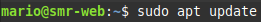<br>
Y comprobaremos la version del sistema con ```lsb_release -a```<br>
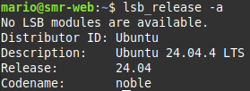<br>
### Apartado 2. Instalación de Apache
Ahora instalaremos Apache con el comando ```sudo apt install apache2 -y```<br>
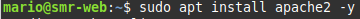<br>
> ¿Qué paquetes adicionales se han instalado como dependencias? (pista: revisa la salida de apt).<br>
Al instalar Apache2 se instalan paquetes adicionales necesarios, como apache2-bin, apache2-data y apache2-utils
### Apartado 3. Comprobación del funcionamiento
Ahora vamos a comprobar el funcionamiento del servidos, estoy hay que hacerlo en 4 partes que son las siguientes:
  1. Con el comando ```sudo systemctl status apache2``` comporbaremos el estado del servicio
  2. Con el comando ```sudo ss -tulpn | grep apache2``` comprobaremos que puertos estan escuchando
  3. Para hacer pruebas las podemos hacer en la terminal o desde el navegador, en la terminal tendriamos que poner el siguiente comando ```curl -I http://localhost``` o en el navegador escribir lo[...]
     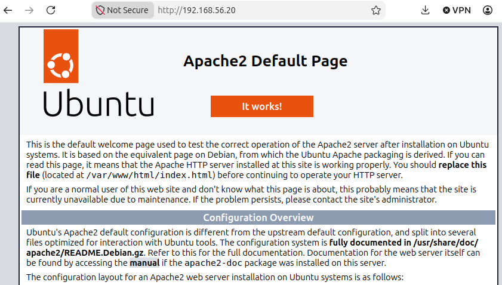<br>
  4. Ahora comprobaremos si el Firewall esta activo y le diremos que deje a 'Apache' hacer lo que tenga que hacer con los siguientes comandos ```sudo ufw status``` y ```sudo ufw allow 'Apache'```<br>
        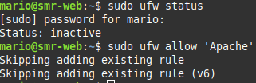<br>
> ¿Qué diferencia hay entre los perfiles Apache, Apache Full y Apache Secure?<br>
Apache: permite el tráfico HTTP por el puerto 80.<br>
Apache Full: permite el tráfico HTTP por el puerto 80 y HTTPS por el puerto 443.<br>
Apache Secure: permite únicamente el tráfico HTTPS por el puerto 443.<br>
### Apartado 4. Comandos principales de administración
En este apartado vamos a probar varios comandos de apache
|Comando                              |Resultado                                      |
|-------------------------------------|-----------------------------------------------|
|```sudo systemctl start apache2```   |Inicia el servicio                             |
|```sudo systemctl stop apache2```    |Detiene el servicio                            |
|```sudo systemctl restart apache2``` |Reinicia (corta conexiones)                    |
|```sudo systemctl reload apache2```  |Recarga la configuración sin cortar conexiones |
|```sudo systemctl enable apache2```  |Arranque automático al iniciar el sistema      |
|```sudo systemctl enable apache2```  |Desactiva el arranque automático               |
|```apache2ctl configtest```          |Comprueba la sintaxis de la configuración      |
|```apache2ctl -S```                  |Muestra los sitios (virtual hosts) cargados    |
|```apache2ctl -M```                  |Lista los módulos cargados                     |
|```a2enmod / a2dismod```             |Activa / desactiva módulos                     |
|```a2ensite / a2dissite```           |Activa / desactiva sitios                      |
|```a2enconf / a2disconf```           |Activa / desactiva fragmentos de configuración |
> ¿Cuándo conviene usar reload en lugar de restart?<br>
Utilizaremos reload cuando no queramos que se detenga el servidor y queramos aplicar los cambios y restart cuando si queramos que se detenga el servidor 
### Apartado 5. Ficheros y directorios importantes
Para explorar la estructura y configuracion del servidor utilizaremos el comando ```ls -l /etc/apache2/```
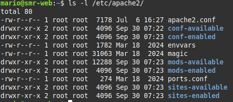<br>
|Ruta                                            |Descripción                                                    |
|------------------------------------------------|---------------------------------------------------------------|
|*/etc/apache2/apache2.conf*                     |Fichero de configuración principal                             |
|*/etc/apache2/ports.conf*                       |Puertos en los que escucha Apache                              |
|*/etc/apache2/sites-available/*                 |Sitios disponibles (definidos, no necesariamente activos)      |
|*/etc/apache2/sites-enabled/*                   |Sitios activos (enlaces simbólicos a sites-available)          |
|*/etc/apache2/mods-available/ y mods-enabled/*  |Módulos disponibles y activos                                  |
|*/etc/apache2/conf-available/ y conf-enabled/*  |Fragmentos de configuración disponibles y activos              |
|*/etc/apache2/envvars*                          |Variables de entorno (usuario y grupo de ejecución, etc.)      |
|*/var/www/html/*                                |Directorio raíz por defecto (DocumentRoot)                     |
|*/var/log/apache2/access.log*                   |Registro de accesos                                            |
|*/var/log/apache2/error.log*                    |Registro de errores                                            |

> ¿Por qué Apache usa enlaces simbólicos entre los directorios *-available* y *-enabled*?<br>
Apache utiliza enlaces simbólicos para separar las configuraciones disponibles de las que están activadas.
### Apartado 6. Modificaciones típicas del servicio
Ahora como vamos a hacer modificaciones al servidor, vamos a hacer una copia de seguridad para que en el caso que algo falle no perdamos el servidor por completo, esto lo haremos con el comando ```sud[...]
Las modificaciones que vamos a hacer son las siguientes: <br>
  **1. Cambiar la página de inicio**<br>
  Para esto utilizaremos el siguiente comando ```echo "<h1>Servidor de TU NOMBRE</h1>" | sudo tee /var/www/html/index.html``` <br>
  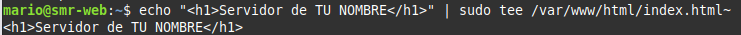<br>
  **2. Cambiar el puerto de escucha**<br>
  Para esto vamos a necesitar utilizar ```sudo nano /etc/apache2/ports.conf```, aqui cambiaremos Listen 80 por Listen 8080, y ```sudo nano /etc/apache2/sites-available/000-default.conf``` donde cambia[...]
  <br>
Para despues utilizar los siguientes comandos ```sudo apache2ctl configtest```, ```sudo systemctl reload apache2``` y ```curl -I http://localhost:8080``` <br>
  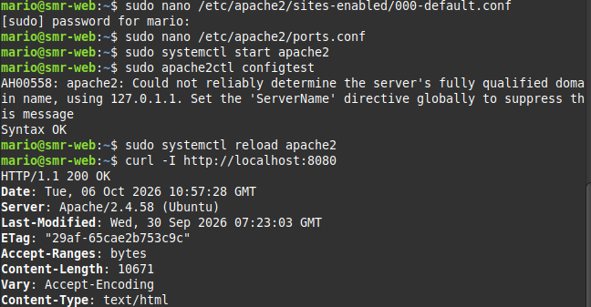<br>
  **3. Definir el nombre del servidor**
  Esto lo vamos a hacer para eliminar el aviso que salia de *"Could not neriably determine the server's fully qualified name"*. Esto lo haremos con los siguientes comandos ```echo "ServerName localhos[...]
 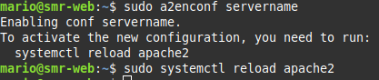<br>
 **4. Cambiar el correo del administrador**
 Para esto entraremos en el fichero 000-default.conf con el comando ```sudo nano /etc/apache2/sites-available/000-default.conf``` y cambiaremos el ServerAdmin por nuestro correo <br>
  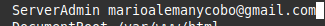<br>
 **5. Personalizar una página de error (por ejemplo, 404) con la directiva ErrorDocument.**
 Para personalizar la pagina de error vamos a crear un html con el comando ```sudo nano /var/www/html/404.html``` y vamos a añadirle el siguiente texto dentro:<br>
 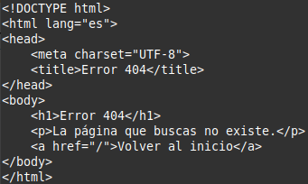<br>
Para despues entrar en el fichero 000default y añadir la siguiente linea *ErrorDocument 404 /404.html* para que asi si da algun error vaya a la siguiente pagina:
  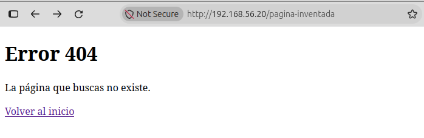<br>
  ### Apartado 7. Módulos de Apache
|Módulo                                          |Función                                                        |
|------------------------------------------------|---------------------------------------------------------------|
|*mod_rewrite*                                   |Nos permite reescribir la URL del servidor                     |
|*mod_headers*                                   |Con esto podemos modificar la cabecera http                    |
|*mod_ssl*                                       |Permite configurar conexiones HTTPS seguras mediante certificados SSL/TLS.     |
|*mod_dir*                                       |Se encarga de gestionar los directorios y de mostrar automáticamente un archivo de inicio          |
|*mod_alias*                                     |Permite crear alias y redirecciones para que una URL pueda mostrar contenido ubicado en otra ruta del servidor                                  |
|*mod_auth_basic*                                |Permite proteger páginas o directorios solicitando un nombre de usuario y una contraseña              |
> ¿Qué ocurre si desactivas un módulo del que depende otro?<br>
Si desactivamos un módulo necesario para otro, Apache puede mostrarnos errores de configuración o impedir que el servicio se inicie correctamente.
### Apartado 8. Varios sitios en un mismo servidor (Virtual Hosts)
En este apartado vamos a crear 2 sitios, primero vamos a crearlos con:<br>
```sudo mkdir -p /var/www/sitio1 /var/www/sitio2```<br>
```echo "<h1>Bienvenido a SITIO 1</h1>" | sudo tee /var/www/sitio1/index.html```<br>
```echo "<h1>Bienvenido a SITIO 2</h1>" | sudo tee /var/www/sitio2/index.html```<br>
Y escribiremos lo siguiente en los dos .html cambiando los 1 por 2 en el sitio2<br>
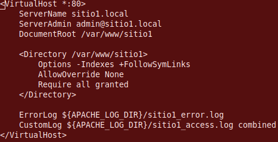<br>
Y añadiremos al ficher /etc/host lo siguiente *127.0.0.1   sitio1.local sitio2.local*
Y probaremos que funcionen con:<br>
```curl http://sitio1.local```<br>
```curl http://sitio2.local```<br>
 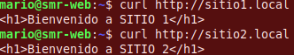<br>
  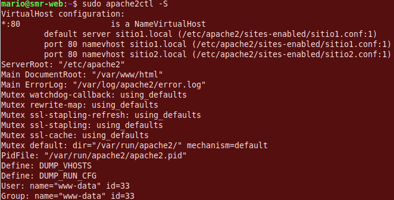<br>
> ¿Qué diferencia hay entre virtual hosts basados en nombre y basados en IP? ¿Cuál has usado?<br>
Que las basadas en el nombre nos permiten alojar varias páginas web en una misma dirección IP y Apache identifica qué sitio debe mostrar según el nombre de dominio solicitado y las basadas en IP u[...]
### Apartado 9. Permisos y propietarios
Le daremos unos permisos razonables a los sitios con los siguientes comandos:<br>
```sudo chown -R www-data:www-data /var/www/sitio1```<br>
```sudo find /var/www/sitio1 -type d -exec chmod 755 {} \;```<br>
```sudo find /var/www/sitio1 -type f -exec chmod 644 {} \;```<br>
Ahora probaremos a quitarle todos los permisos a index.html
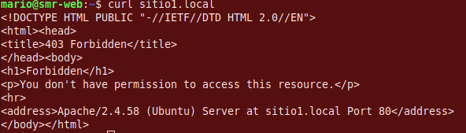<br>
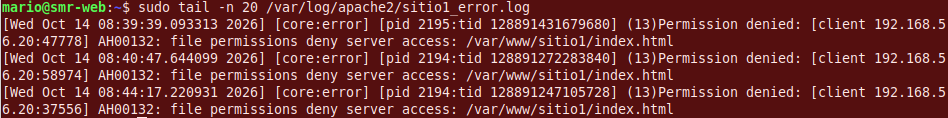<br>

> Qué significan 755 y 644.
El 755 significa que el propietario puede leer, escribir y ejecutar y el grupo y los demás usuarios pueden leer y ejecutar, pero no modificar.
El 644 significa que el propietario puede leer y escribir. El grupo y los demás usuarios solo pueden leer el archivo.
> Por qué nunca se deben usar permisos 777 en un servidor web.
Porque permiten que cualquier usuario pueda leer, modificar y ejecutar archivos. Esto supone un riesgo de seguridad, ya que alguien podría modificar la página web o introducir código malicioso.
> Por qué el contenido web no debe pertenecer a root ni ser escribible por todos.
Porque Apache necesita acceder a los archivos para mostrar la página web, pero no es necesario que tenga permisos para modificarlos. Si los archivos fueran escribibles por todos, cualquier usuario po[...]

## Conclusión

En esta practica he podido aprender a instalar y configurar apache Server, y hacer modificaciones dentro de este, aparte de aprender a gestionar los modulos y permisos que este lleva. Ademas de poder aprender varios conceptos como los 'VirtualHost' basados en IP/Nombre 
