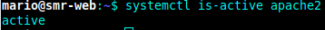
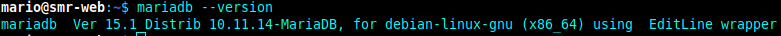
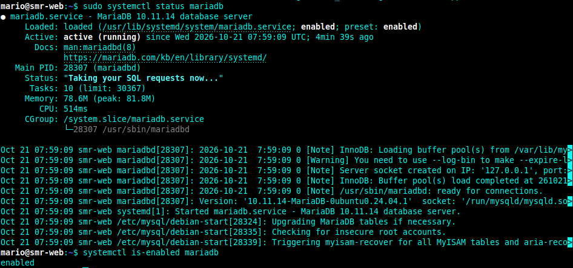
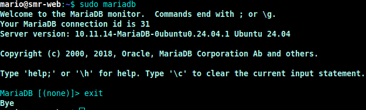
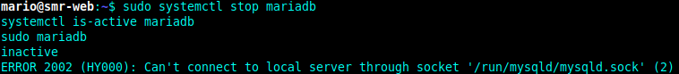

# Práctica: Instalación de MariaDB y PHP en Ubuntu 24.04 (completando el LAMP)

<p align="center">
 
</p>

<p align="center">
  <strong>🌐 INSTALACIÓN · CONFIGURACIÓN</strong>
</p>

---

<p align="center">
   💻 APLICACIONES WEB
</p>

<br>

##  Datos del alumno

- **Nombre:** Mario Alemany Cobo
- **Curso:** 2º SMR
- **Fecha:** 23/10/2026

---
## 4. Desarrollo de la práctica
### Apartado 1. Preparación del sistema
En este apartado vamos a preparar el sistema para poder instalar MariaDB y PHP correctamente. Para esto vamos a borrar los sitios que hicimos en la practica anterior y actualizaremos apache  y comprobaremos que siga funvionando con el siguiente comando:
<br>
### Apartado 2. Instalación de MariaDB
Y ahora instalaremos MariaDB con el siguiente comando ```sudo apt install mariadb-server -y``` y comprobaremos la version con:
<br>
### Apartado 3. Comprobación del funcionamiento
Vamos a comprobar el estado en el que se encuentra MariaDB
<br>
Y entraremos en la base de datos d MariaDB con el siguiente comando:
<br>
### Apartado 4. Comandos principales

|Comando                      | Función             |
|-------------------------------------|-----------------------------------------------|
|```sudo systemctl start mariadb``` | Arranca el servicio |
|```sudo systemctl stop mariadb```| Detiene el servicio |
|```sudo systemctl restart mariadb```| Reinicia el servicio |
|```sudo systemctl status mariadb```| Muestra su estado |
|```sudo systemctl enable mariadb```| Lo arranca automáticamente al encender el equipo |

### Apartado 5. ¿Qué pasa si MariaDB está parado?

<br>
### Apartado 6. Instalación de PHP
| Paquete | Función |
|---|---|
| ```php``` | El lenguaje PHP |
| ```libapache2-mod-php``` | Permite a Apache ejecutar PHP |
| ```php-mysql``` | **Permite a PHP hablar con MariaDB (imprescindible)** |
| ```php-curl``` | Conexiones a otros servidores (actualizaciones, plugins) |
| ```php-gd``` | Tratamiento de imágenes |
| ```php-mbstring``` | Manejo de textos con tildes y caracteres especiales |
| ```php-xml``` | Lectura y escritura de ficheros XML |
| ```php-zip``` | Instalación y actualización de plugins y temas |
| ```php-intl``` | Idiomas y formatos regionales |
