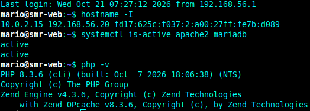
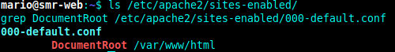
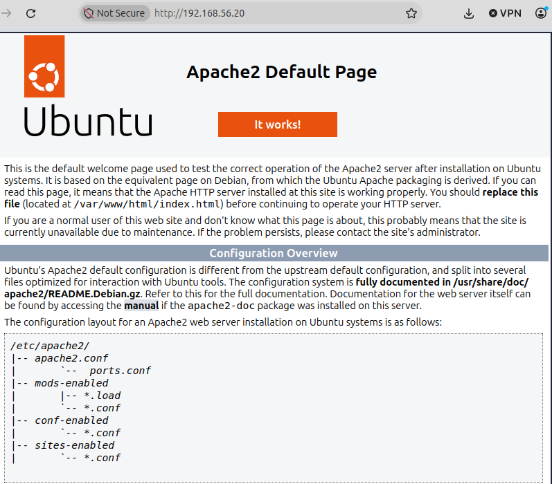
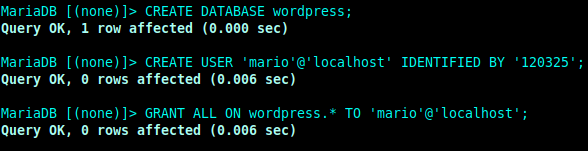
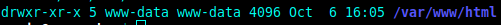

# Práctica: Instalación de WordPress en Ubuntu 24.04 (nuestro LAMP en marcha)

<p align="center">
 
</p>

<p align="center">
  <strong>🌐 INSTALACIÓN · CONFIGURACIÓN</strong>
</p>

---

<p align="center">
   💻 APLICACIONES WEB
</p>

<br>

##  Datos del alumno

- **Nombre:** Mario Alemany Cobo
- **Curso:** 2º SMR
- **Fecha:** 28/10/2026

---
## 5. Desarrollo de la práctica

### Apartado 1. Conexión por SSH y comprobación del servidor
Para empezar la practica vamos a necesitar establecer la conexion a traves de ssh con ```ssh TU_USUARIO@IP_DEL_SERVIDOR``` y comprobaremos que todo lo que hemos ehcho en las practias anteriores sigue funcionando con: <br>
```
systemctl is-active apache2 mariadb
php -v
```

<br>

> ¿Qué dos "puertas" (programas y puertos) usas para trabajar con el servidor en esta práctica y para qué sirve cada una?<br>
Utilizo SSH, que funciona por el puerto 22, para conectarme al servidor desde la terminal y ejecutar comandos. También utilizo HTTP, que funciona por el puerto 80, para acceder a WordPress desde el navegador y ver la página web

### Apartado 2. Dejar Apache con un único sitio
En este apartado vamos a desactivar los dos sitios que teníamos creados en la práctica anterior y activaremos  el sitio por defecto de Apache con los siguientes comandos:
```
sudo a2dissite sitio1.conf sitio2.conf
sudo a2ensite 000-default.conf
sudo apache2ctl configtest
sudo systemctl reload apache2
```
Después, comprobamos que solo hay un sitio activo y que podemos acceder al servidor desde el navegador utilizando la dirección IP

<br>
*no sabia si la captura era de todos los comandos del apartado 2 o si era solo los que habia arriba, por eso solo he hecho los de arriba*
<br>

> ¿Qué diferencia hay entre desactivar un sitio con a2dissite y borrar sus ficheros? ¿Por qué ahora ves la página por defecto de Apache y antes veías sitio1?<br>
Desactivar un sitio con a2dissite hace que Apache deje de utilizarlo, pero sus archivos siguen guardados en el servidor. En cambio, borrar sus ficheros elimina esos archivos. Ahora veo la página por defecto porque he desactivado los sitios anteriores y he activado 000-default.conf. Antes veía sitio1 porque estaba configurado como el sitio que Apache mostraba al acceder al servidor.

### Apartado 3. Crear la base de datos de WordPress
En este apartado vamos a crear la base de datos de wordpress y nuestro usuario y le daremos los permisos necesarios. Entraremos en maria db con el comando `sudo mariadb` <br>
Y crearemos lo siguiente:
| Qué creamos | Nombre | Para qué | Comando que utilizamos |
| :--- | :--- | :--- | :--- |
| El **armario** (base de datos) | `wordpress` | Donde WordPress guardará todos sus datos | `CREATE DATABASE wordpress;` |
| La **llave** (usuario) | `wp_user` | Con lo que WordPress entrará en el armario | `CREATE USER 'TU_USUARIO'@'localhost' IDENTIFIED BY '*TU_CONTRASEÑA*';` |
| El **permiso** | Todos, pero **solo sobre** `wordpress` | Esa llave abre ese armario y ningún otro | `GRANT ALL ON wordpress.* TO 'wp_user'@'localhost';` |

<br>

> ¿Por qué crees que WordPress usa su propio usuario wp_user con permiso solo sobre su base y no el usuario root de MariaDB?<br>
Porque es más seguro utilizar un usuario que solo tenga permisos sobre la base de datos de WordPress. Así, si alguien consigue acceder a WordPress, tendrá menos posibilidades de modificar o borrar otras bases de datos del servidor. El usuario root tiene permisos mucho más amplios y sería más peligroso utilizarlo.

### Apartado 4. Descargar e instalar los ficheros de WordPress
Ahora vamos a descargarnos e instalarnos los ficheros de wordpress, primero necesitaremos descargarlos y descomprimirlos con los siguientes comandos: 
```
sudo apt install wget -y
cd /tmp
wget https://wordpress.org/latest.tar.gz
tar -xzf latest.tar.gz
ls wordpress
```
Ahora lo que vamos va a ser sustituir la pagina de bienvenida de Apache, ya que esta tiene prioridadsobre WordPress y copieremos todo el contenido de la carpeta que hemos extraido anteriormente a la carpeta de nuestro sitio, esto lo haremos con los siguientes comandos: 
```
sudo rm /var/www/html/index.html
sudo cp -a /tmp/wordpress/. /var/www/html/
rm -r /tmp/wordpress /tmp/latest.tar.gz
ls /var/www/html
```
Para acabar este apartado, vamos a darle los permisos correctos con los siguientes comandos:
```
sudo chown -R www-data:www-data /var/www/html
sudo find /var/www/html -type d -exec chmod 755 {} \;
sudo find /var/www/html -type f -exec chmod 644 {} \;
ls -ld /var/www/html
```
<br>

> Explica qué hace cada uno de los comandos que acabas de ejecutar.<br>
**sudo apt install wget -y**: instala la herramienta wget, que sirve para descargar archivos de Internet.<br>
**cd /tmp**: entra en la carpeta temporal del sistema.<br>
**wget https://wordpress.org/latest.tar.gz**: descarga el archivo comprimido de WordPress desde su página oficial.<br>
**tar -xzf latest.tar.gz**: descomprime el archivo descargado y crea la carpeta wordpress.<br>
**ls wordpress**: muestra los archivos y carpetas que contiene WordPress.<br>
**sudo rm /var/www/html/index.html**: elimina la página de bienvenida de Apache para que no tenga prioridad sobre WordPress.<br>
**sudo cp -a /tmp/wordpress/. /var/www/html/**: copia todos los archivos de WordPress a la carpeta que utiliza Apache para mostrar la web.<br>
**rm -r /tmp/wordpress /tmp/latest.tar.gz**: elimina la carpeta temporal de WordPress y el archivo comprimido, ya que los archivos necesarios están copiados en su ubicación definitiva.<br>
**ls /var/www/html**: muestra el contenido de la carpeta donde hemos instalado WordPress.<br>
**curl -I http://localhost**: consulta las cabeceras HTTP que devuelve el servidor local para comprobar su respuesta.<br>

> Explica qué hace cada una de las órdenes que has ejecutado. ¿Por qué hay que cambiar el propietario de la carpeta de WordPress a www-data? ¿Qué podría fallar si siguiera siendo tu usuario?<br>
Es necesario cambiar el propietario a www-data para que Apache pueda trabajar correctamente con los archivos de WordPress. Si siguiera siendo mi usuario, podrían aparecer problemas al subir imágenes, instalar plugins o modificar archivos desde el panel de administración.

### Apartado 5. Terminar la instalación desde el navegador (la parte gráfica)

> ¿Qué partes de la instalación has hecho en la terminal y cuáles en el navegador? ¿Por qué el servidor no necesita tener interfaz gráfica?<br>
En la terminal he comprobado los servicios, configurado Apache, creado la base de datos y su usuario, descargado los archivos de WordPress y configurado sus permisos. En el navegador he terminado la instalación, indicando los datos de conexión a la base de datos, el título de la web y el usuario administrador.

### Apartado 6. Comprobamos que WordPress funciona

> ¿Dónde guarda WordPress las entradas que escribes: en ficheros del servidor o en la base de datos? ¿Cómo lo has comprobado?<br>
WordPress guarda las entradas en la base de datos de MariaDB, concretamente en la tabla wp_posts. Lo he comprobado ejecutando el comando sudo mariadb wordpress -e "SHOW TABLES;", que muestra las tablas creadas por WordPress. Los archivos de la web se guardan en /var/www/html, pero el contenido de las entradas se almacena en la base de datos

### Apartado 7. Para que no se rompa si cambia la IP (recomendado)


### Apartado 8. Dos ajustes para trabajar cómodamente

> ¿Por qué las direcciones "bonitas" dan error 404 si Apache no tiene permitido leer el fichero .htaccess?<br>
Porque WordPress utiliza el archivo .htaccess para indicar a Apache cómo gestionar las direcciones de las entradas. Si Apache no tiene permitido leer ese archivo, no aplica las reglas necesarias para encontrar las páginas y puede mostrar un error 404, que significa que no se ha encontrado la página solicitada.

### Apartado 9. ¿Qué pasa si MariaDB se para?

> Cuando WordPress muestra "Error al establecer una conexión con la base de datos", ¿qué dos cosas comprobarías y en qué orden?<br>
Primero comprobaría si MariaDB está funcionando con el comando systemctl is-active mariadb. Si está parado, lo iniciaría con sudo systemctl start mariadb.<br>
Si MariaDB está funcionando, comprobaría que el usuario, la contraseña y el nombre de la base de datos sean correctos. Para ello, intentaría conectarme con mariadb -u *'usuario'* -p wordpress.

### Apartado 10. Comprobación final
